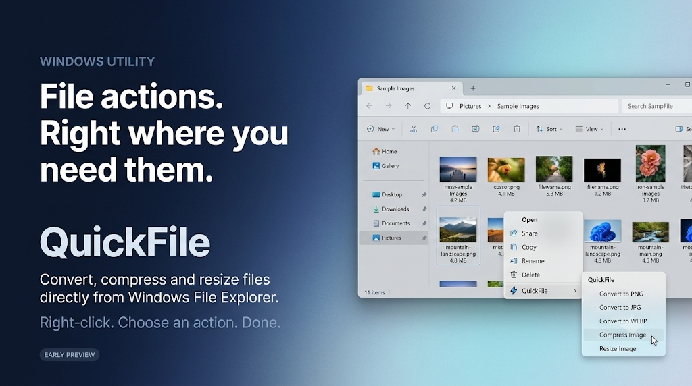

# QuickFile

> **Quick file actions, right from Windows File Explorer.**

A lightweight, zero-overhead Windows desktop utility that embeds common file operations directly into Windows File Explorer's right-click context menu. Perform conversions, compression, resizing, and inspections without launching heavy photo editing suites or keeping background processes running.

---


*Early preview & product concept mockup of QuickFile's context-menu integration.*

---

## What QuickFile Does

Modern desktop file workflows often require quick, repetitive tasks—converting a PNG to WebP for the web, shrinking a JPEG to fit an upload limit, or resizing a screenshot. Traditional tools force you to launch slow editing software, open cluttered web converters, or run heavy background services.

**QuickFile removes all friction:**
1. **Right-click** any supported image in File Explorer.
2. **Hover** over **QuickFile**.
3. **Select an action**—convert immediately or configure via a compact mini window.
4. **Done.** Output files are generated alongside your original with atomic safety.

---

## Features

- **Direct Shell Integration**: Integrates into the Windows 10 & 11 context menu. In Windows 11, bypasses the "Show more options" extra step so your actions are accessible on first click.
- **Zero Runtime Overhead**: **0 MB RAM and 0% CPU at idle**. QuickFile does not run background services, tray pollers, or daemons. It executes on-demand when invoked and closes immediately.
- **Instant Format Conversion**: 1-click conversion between PNG, JPG, WEBP, and BMP with silent desktop toast confirmation.
- **Quality & Budget Compression**:
  - **Compress Image**: Adjust quality slider (10%–100%) with live size-reduction estimation.
  - **Compress to Target Size**: Enter a target file size (e.g. `250 KB`, `1 MB`), and QuickFile iteratively fits the image within your target budget without unnecessary degradation.
- **Smart Image Resizing**: Width & Height inputs, locked aspect ratio toggle, and quick scale presets (`25%`, `50%`, `75%`, `1080p`, `720p`) powered by high-quality SkiaSharp resampling.
- **Distraction-Free Mini Window**: When input is needed, QuickFile opens a tiny, focused window right beside your cursor. No sidebars, no dashboards, no accounts, and no alert sounds.
- **Silent Acrylic HUD**: Quick operations display an unobtrusive, silent floating toast notification with an "Open Folder" action, automatically fading after 3 seconds.
- **Guaranteed File Safety**: Never overwrites your original files by default. Uses temporary staging files and atomic moves to guarantee zero corrupted partial files.

---

## How It Works

QuickFile uses Windows Shell native static cascading context menu verbs registered in `HKEY_CURRENT_USER\Software\Classes\SystemFileAssociations\image\shell\QuickFile`. 

- **No In-Process DLL Injection**: Explorer remains fast and stable; no foreign code runs inside `explorer.exe`.
- **No Administrator Privileges Required**: Installs and uninstalls entirely within user space (`HKCU`).
- **SkiaSharp Imaging Engine**: High-performance, cross-platform 2D graphics engine (MIT licensed) for fast SIMD-accelerated image encoding and decoding.

---

## Supported File Formats

| Format | Read | Write | Common Use Case |
| :--- | :---: | :---: | :--- |
| **PNG** | Yes | Yes | Screenshots, transparency, lossless graphics |
| **JPG / JPEG** | Yes | Yes | Photographs, standard web images |
| **WEBP** | Yes | Yes | High-efficiency modern web publishing |
| **BMP** | Yes | Yes | Raw uncompressed bitmaps |

---

## Getting Started

### Prerequisites
- Windows 10 (version 1809+) or Windows 11 (64-bit).
- [.NET 9.0 Desktop Runtime](https://dotnet.microsoft.com/download/dotnet/9.0) (or SDK if building from source).

### Quick Install & Context Menu Setup

1. Download or build `QuickFile.exe`.
2. Open terminal in the application directory and run:
   ```cmd
   QuickFile.exe --register
   ```
   Or double-click `QuickFile.exe` to open the Settings window and click **Register**.
3. Right-click any image in Windows Explorer to start using QuickFile!

### Clean Uninstallation
To completely remove QuickFile from your context menu and registry:
```cmd
QuickFile.exe --unregister
```
Leaves zero registry artifacts and requires no system restart.

---

## CLI & Automation

QuickFile supports direct command-line execution:

```cmd
:: Convert an image to WEBP
QuickFile.exe --action convert --format webp "C:\Photos\image.png"

:: Open the interactive Compression dialog
QuickFile.exe --action compress "C:\Photos\image.png"

:: Open the Target Size Compression dialog
QuickFile.exe --action compress-target "C:\Photos\image.png"

:: Open the Resize dialog
QuickFile.exe --action resize "C:\Photos\image.png"

:: Copy absolute file path to clipboard
QuickFile.exe --action copy-path "C:\Photos\image.png"

:: View file specifications
QuickFile.exe --action info "C:\Photos\image.png"
```

---

## Current Limitations

- **Image Scope (v1.0)**: Currently focused on PNG, JPG, WEBP, and BMP images. Video, audio, and PDF features are planned for future versions.
- **Batch Processing**: Multiple selected items currently open per selection; a centralized multi-file queue manager is scheduled for v1.1.

---

## Building from Source

```bash
# Clone the repository
git clone https://github.com/Naveen-io/QuickFile.git
cd QuickFile

# Restore and build the solution
dotnet build QuickFile.sln -c Release
```

The compiled binary will be located in:
`src/QuickFile.App/bin/Release/net9.0-windows/QuickFile.exe`

---

## Roadmap

- [x] Windows 10 & 11 cascading Shell context menu integration
- [x] Instant format conversion (PNG, JPG, WEBP, BMP)
- [x] Quality-based compression with live reduction estimator
- [x] Iterative target file size compression (KB/MB budget matching)
- [x] Interactive resizing with aspect ratio lock and presets
- [x] Silent Acrylic floating notification HUD
- [ ] Multi-file batch queue dialog with progress bar
- [ ] PDF to image and image to PDF quick conversion
- [ ] Drag-and-drop quick action drop target

---

## License

This project is licensed under the [MIT License](LICENSE).
